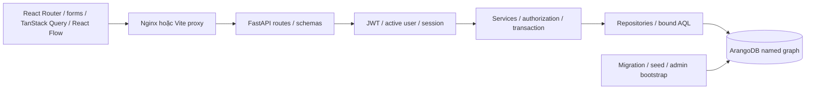

# Kiến trúc ứng dụng

Modular monolith FastAPI/Pydantic, ArangoDB là nguồn dữ liệu chính. Package
`database` giữ migrations, seed, integrity audit và core AQL; package `backend`
chứa HTTP application và 14 modules theo detai.md. `frontend` là React/TypeScript,
tổ chức auth/profiles/jobs/network/referrals/notifications/dashboard theo feature.

Mỗi module có schemas, repository, service, API và tests. Boundaries và acceptance
ở [backend.md](backend.md); routes không chứa AQL. Profiles dùng embedded profile
trong users nhưng có repository/service/API riêng. Company membership độc lập
works_at. Graph/Matching đọc qua GraphQueries đã kiểm chứng; actor đến từ JWT.
Auth credentials/families/sessions tách user profile, không thuộc traversal.

Request: Pydantic validate → JWT verify issuer/audience/expiry/algorithm → active
user/session → resource policy → service transaction/repository → allowlisted DTO.
Error handler trả envelope, request IDs và logs có route template/duration.

Mutation dùng stream transaction exclusive 19 policy/business collections theo
thứ tự cố định, _graphs read, allow_implicit=false. Account/session, privacy, live
paths, employment, job, quotas và uniqueness được recheck dưới khóa rồi write
workflow/history/notification/audit trong cùng transaction. Mọi exception abort.
Password hashing tách khỏi khóa. ETag If-Match chống lost update, unique indexes
và persisted idempotency xử lý duplicate/retry. Chính sách serialization phục vụ
MVP single server; tối ưu throughput hoặc cluster cần thêm đo và thiết kế lock scope.

Compose profile api chạy backend non-root OS và non-root database account;
profile web thêm Nginx non-root phục vụ build frontend và proxy API cùng origin. Runtime
không có quyền DDL; migration/operator credentials tách biệt. Startup kiểm tra
schema/index/graph và fail khi drift, không tự sửa/migrate. Dependencies và Docker
base pin; không thêm Redis/Celery/search khi chưa có nhu cầu đo được.

Frontend không truy cập ArangoDB trực tiếp. API client có refresh single-flight,
generation guard với phản hồi đến trễ, If-Match/idempotency và error envelope.
Cache query theo phiên; profile/graph nhạy cảm chỉ giữ khi trang còn hoạt động,
poll quyền và refetch khi focus. Role/participant gating trong UI bổ sung cho
authorization bắt buộc ở server. Chi tiết: [frontend.md](frontend.md).

Điểm chưa có: UI quản trị/companies/applications, upload/signed URLs, realtime/email,
retention purge, production TLS/hosting, cluster và matching hiệu chỉnh dữ liệu thật.
