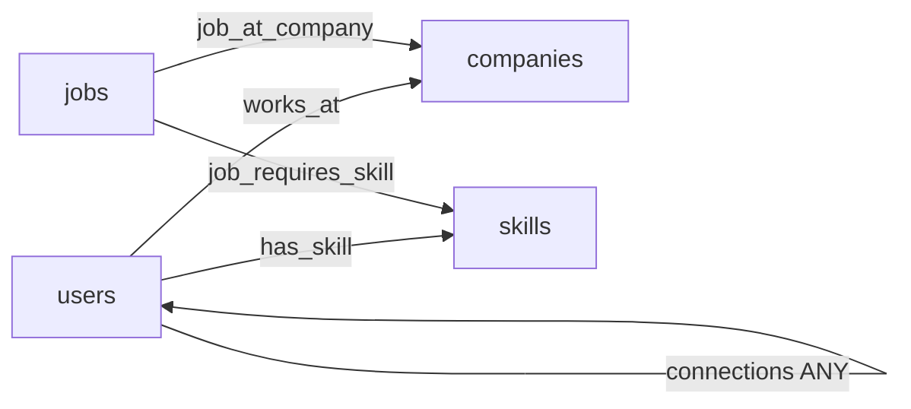

# Graph schema v1 — quyết định đã chốt

Named graph: `jobReferralGraph`. Source of truth có version nằm trong
`database/migrations/001_initial_schema.json`; indexes ở migration `002`.

| Edge | `_from` | `_to` | Cách đọc | Ý nghĩa và ràng buộc |
| --- | --- | --- | --- | --- |
| connections | users | users | ANY | Một cạnh/cặp; endpoints sắp theo `_id`; không tự kết nối; inviter thuộc cặp; pending/accepted/rejected/blocked; soft delete |
| works_at | users | companies | OUTBOUND từ user, INBOUND từ company | Một quan hệ/cặp; current/ended; verified; start_at/end_at; khi chuyển công ty kết thúc cạnh cũ |
| has_skill | users | skills | OUTBOUND | Một kỹ năng/user; proficiency 1–5; years_experience >= 0 |
| job_requires_skill | jobs | skills | OUTBOUND | Một yêu cầu/job/skill; required hoặc preferred; proficiency và năm tối thiểu |
| job_at_company | jobs | companies | OUTBOUND | Unique `_from`: đúng một công ty/job; không lặp company_id trong job |

Vertex: `users`, `companies`, `jobs`, `skills`. `applications`,
`referral_requests`, `notifications`, `audit_logs` là orphan collections trong
named graph: lưu workflow bằng document references, không dùng để suy ra tình bạn.
Experience/education MVP là thuộc tính hồ sơ có giới hạn; chưa tách vertex nên
không tạo `has_experience`/`has_education`.

Chỉ `connections` được phép tạo đường xã hội; chỉ `works_at` xác định nhân viên.
Cùng công ty/kỹ năng không tạo đường xã hội. Traversal dùng named graph với
`edgeCollections: ["connections"]`, `vertexCollections: ["users"]`, BFS,
`uniqueVertices: "path"`, `uniqueEdges: "path"` để giữ nhiều đường mà tránh cycle.
Không dùng shortest-path không có bộ lọc rồi loại kết quả: đường hợp lệ ngắn nhất
được chọn từ traversal đã prune trạng thái/quyền và giới hạn 1–3 bước.

Quyền: actor là user active; mọi node trung gian/referrer phải active,
discoverable và allow_in_paths; endpoint phải employment_visible. Bất kỳ user
đã blocked với actor bị loại cả khi đi qua đường khác. Không tiết lộ email, CV,
roles, metadata riêng tư. `works_at` chỉ hợp lệ khi verified, current,
start_at <= as_of và end_at chưa đến. Tin đóng không có cơ hội giới thiệu.

`_key` production là UUID; seed dùng key cố định `demo_*`, không dùng tên người
làm định danh. API tương lai chỉ nhận ID nghiệp vụ, server dựng `_from`/`_to`.
JSON Schema không kiểm tra khóa ngoại/system fields. Writer đọc named graph
definition để kiểm tra allowed endpoint collections, rồi kiểm tra tồn tại
endpoints trong cùng stream transaction ghi cạnh. Không dựa chỉ vào graph HTTP
API để bảo đảm mọi ràng buộc endpoint; integration test thực tế kiểm chứng writer.
Seed chạy transaction sau khi kiểm tra toàn bộ endpoints. Writer chuẩn hóa endpoints;
unique pair chống race/reverse duplicate. Direct collection writes chỉ dành cho
migration/seed đã kiểm tra; không cấp database credentials cho client.

Xóa: users suspended/deleted bị loại tức thì; connections có deleted_at; works_at
ended giữ lịch sử; jobs closed/archived không xuất hiện ở matching. Không hard
delete workflow/audit bằng graph cascade. Job_company là quan hệ bắt buộc ở writer
tương lai; unique index chỉ đảm bảo tối đa một, seed/integrity audit đảm bảo đúng
một. Không claim DB schema tự đảm bảo mọi business rule.
