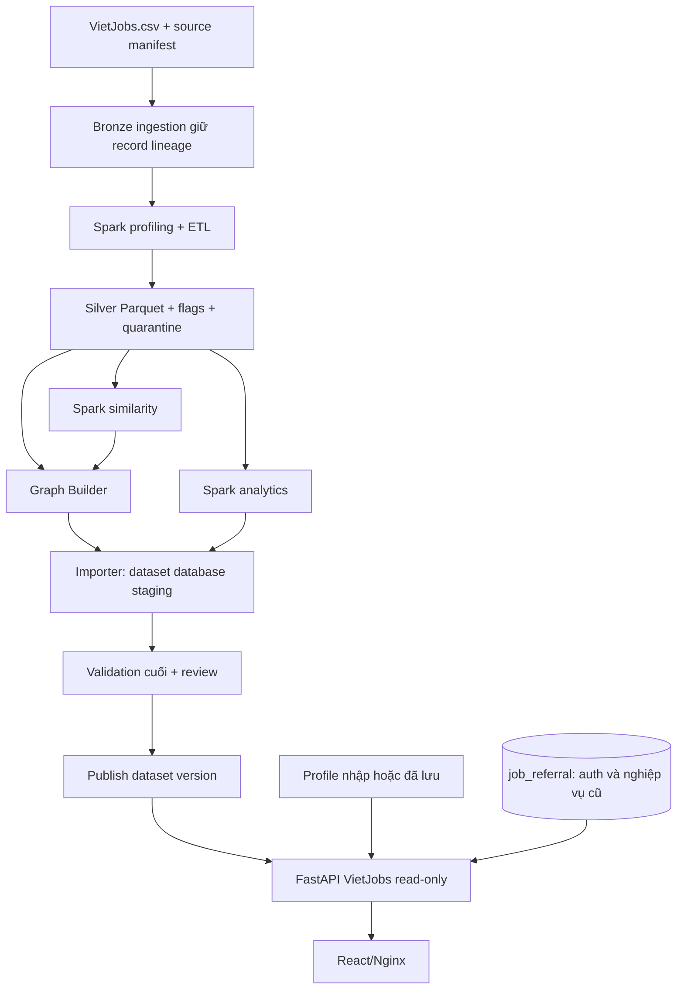

# Kế hoạch triển khai VietJobs v2 — từ dữ liệu nguồn đến hệ thống và báo cáo

Ngày: 13/10/2026. Mục đích: chốt phương án kỹ thuật đề xuất và quy trình triển khai để nhóm thực hiện. Đây là tài liệu kế hoạch, không phải xác nhận đã xây xong hệ thống hay đã được giảng viên duyệt.

**Thời hạn người dùng xác nhận: 3 ngày.** Áp dụng [kế hoạch 3 ngày](ke-hoach-vietjobs-3-ngay.md) thay cho lịch 18 ngày ở mục 10. Các mục kỹ thuật ở đây là tham chiếu; nội dung tối ưu/mở rộng chỉ triển khai nếu không ảnh hưởng luồng bắt buộc và kiểm thử cuối.

Tài liệu này cập nhật [đặc tả chi tiết v1](ke-hoach-vietjobs-spark-arangodb.md). Khi có khác biệt ở môi trường, dữ liệu thiếu, lương, scoring, similarity, publish và lịch thực hiện, áp dụng v2. Không sửa raw, database, Word hoặc PPT trong lượt lập kế hoạch này.

## 1. Phương án xây dựng được đề xuất

**VietJobs là nguồn trung tâm; Spark xử lý theo lô; ArangoDB lưu quan hệ; FastAPI phục vụ dữ liệu và gợi ý; React phục vụ người dùng.**

Tên mô tả: “Khám phá và gợi ý việc làm dựa trên mạng lưới kỹ năng bằng ArangoDB và Apache Spark”. Nếu phải giữ tên đăng ký, định nghĩa rõ “giới thiệu” ở nhánh VietJobs là recommendation, còn referral qua người quen là nhánh cũ độc lập.

Sản phẩm có hai phạm vi được ghi rõ trên điều hướng:

- **Nhánh chính VietJobs:** dữ liệu tuyển dụng lịch sử, tìm kiếm, hồ sơ kỹ năng, matching, gap, việc tương tự, graph và analytics.
- **Nhánh Job Referral hiện có:** tài khoản, kết nối, employment, referral/application, notifications; giữ hoạt động trên dữ liệu hiện có. Không dùng người demo làm nhân viên của công ty suy ra từ VietJobs.

Không cam kết tin hiện vẫn đang tuyển, không tự tạo công ty/URL tuyển dụng/ngày đăng, không tự suy ra quan hệ người dùng. Mục tiêu đồ án là pipeline và khai thác dữ liệu có thể kiểm chứng.

## 2. Giữ và bổ sung chức năng

| Nhóm hiện có | Hành động | Phạm vi sử dụng |
|---|---|---|
| React/FastAPI/Nginx/Compose | Giữ | Tái sử dụng kiến trúc, components và cách tổ chức modules |
| Register/login/logout/profile/privacy | Giữ | Tài khoản và lưu tiêu chí cá nhân; public VietJobs không bắt buộc login |
| Tìm kiếm/chi tiết jobs | Giữ nhánh cũ; bổ sung API/UI VietJobs | Không ép schema công ty/status của nhánh cũ lên dataset |
| Matching | Giữ engine cũ; thêm service scoring VietJobs riêng | Có version và giải thích phù hợp dữ liệu mới |
| Social graph/connections/works_at | Giữ, tách điều hướng | Không phải graph lõi VietJobs |
| Referral/applications/company admin | Giữ, ngoài demo dữ liệu chính | Chỉ phục vụ job/entity hợp lệ của nhánh cũ |
| Notifications/audit | Giữ | Không tạo thông báo tuyển dụng giả |
| Spark ETL và analytics | Xây mới | Raw→Silver→Gold có lineage |
| Categories/locations/skill graph | Xây mới | Graph dữ liệu tuyển dụng |
| Similar Jobs/Skill Gap | Xây mới | Khám phá công việc và yêu cầu liên quan |
| Dashboard chất lượng và thị trường | Xây mới | Phạm vi snapshot và mẫu số rõ ràng |

Public catalog 29 tin và seed demo không bị xóa hoặc nhập trộn vào VietJobs. Việc giữ module không đồng nghĩa phải mở rộng tất cả module trong đồ án.

## 3. Kiến trúc và luồng sử dụng



**Batch:** người vận hành chạy Spark khi tạo snapshot mới. **Online:** người dùng tìm kiếm/nhập hồ sơ; API đọc ArangoDB và scoring; không khởi động Spark theo mỗi request.

ArangoDB chạy single server hiện có nhưng tạo database dataset riêng. Backend có hai connection config; không đổi `ARANGO_DATABASE` cũ sang schema VietJobs. Profile cá nhân thuộc database cũ; dataset DB public là read-only đối với API. Không tạo edge xuyên database.

## 4. Dữ liệu đầu vào và kiểm tra nguồn

Tệp hiện có: `DATA_/vietjobs-network/data/raw/vietjobs/VietJobs.csv`, 103.110.903 byte; khảo sát cục bộ trước đó: 48.092 rows, 18 columns, 16 categories. Đây là số đã đo file hiện có bằng Python CSV, phải xác nhận lại bằng Spark sau thiết lập.

Nguồn lựa chọn: [dinhieufam/VietJobs](https://huggingface.co/datasets/dinhieufam/VietJobs). Tài liệu nghiên cứu: [VietJobs, LREC 2026](https://aclanthology.org/2026.lrec-1.501.pdf). File raw không có ID công ty/URL tin/ngày đăng; source dataset không được hiển thị như trang tuyển dụng gốc của mỗi tin.

Trước phân phối dữ liệu: đọc điều kiện sử dụng của nguồn, ghi revision được tải và checksum. Nếu file có sẵn không rõ revision, ghi unknown; không suy ra revision từ ngày tạo file.

## 5. Thiết lập và tải dữ liệu: các lệnh cụ thể

### 5.1. Phân loại lệnh

- **Lệnh thiết lập dưới đây:** dùng các công cụ hiện hành, cần cài môi trường trước và có thể cần quyền download. Chưa thực thi hoặc smoke-test trên máy này trong lượt lập kế hoạch.
- **Script pipeline/import đề xuất ở mục 9:** chưa tồn tại; phải xây rồi kiểm tra trước khi chạy.
- CSV hiện đã có; không cần tải lại để bắt đầu khảo sát. Tải mới vào thư mục incoming, không ghi đè raw hiện tại.

### 5.2. Kiểm tra môi trường Windows

Mở PowerShell ở repository root:

```powershell
Set-Location 'E:\Hoc BigData\bigdata\bigdata'
Get-PSDrive -Name C,D,E
Get-Command python,java,docker -ErrorAction SilentlyContinue
python --version
java -version
docker info --format '{{.ServerVersion}}'
Get-FileHash -LiteralPath '.\DATA_\vietjobs-network\data\raw\vietjobs\VietJobs.csv' -Algorithm SHA256
```

Quan sát máy hiện tại: `.venv` backend dùng Python 3.13.0; có JDK 17.0.19 và 21.0.10; Python launcher `py` chưa tìm thấy runtime đăng ký. Không giả định `py -3.11` đã chạy được. Không đổi Python backend để chạy Spark.

### 5.3. Môi trường Spark đề xuất

Baseline: Python 3.11 + PySpark 3.5.7 + Java 17, môi trường riêng. Đây là lựa chọn có tài liệu cài đặt, cần smoke-test và pin lockfile trước triển khai; không tuyên bố tối ưu hay mới nhất. Không dùng Python 3.13 hiện có làm baseline Spark nếu chưa kiểm tra tương thích thực tế.

Nếu Python 3.11 chưa có, cài bằng bộ cài chính thức do nhóm lựa chọn; dùng đường dẫn thật đã kiểm tra. Sau đó:

```powershell
$vietjobsPython311 = 'D:\Tools\Python311\python.exe' # VÍ DỤ: thay bằng runtime đã cài
if (-not (Test-Path -LiteralPath $vietjobsPython311)) { throw 'Cần đường dẫn Python 3.11 thực tế' }
& $vietjobsPython311 -m venv .venv-spark
.\.venv-spark\Scripts\python.exe -m pip install --upgrade pip
.\.venv-spark\Scripts\python.exe -m pip install 'pyspark==3.5.7' huggingface_hub
.\.venv-spark\Scripts\python.exe -m pip freeze > .\DATA_\vietjobs-network\requirements-etl.lock
$env:JAVA_HOME = 'C:\Program Files\Java\jdk-17.0.19' # kiểm tra lại trên máy khác
if (-not (Test-Path -LiteralPath "$env:JAVA_HOME\bin\java.exe")) { throw 'JAVA_HOME chưa đúng' }
$env:Path = "$env:JAVA_HOME\bin;$env:Path"
$env:PYSPARK_PYTHON = (Resolve-Path '.\.venv-spark\Scripts\python.exe').Path
$env:PYSPARK_DRIVER_PYTHON = $env:PYSPARK_PYTHON
$env:SPARK_LOCAL_IP = '127.0.0.1'
.\.venv-spark\Scripts\python.exe -c "from pyspark.sql import SparkSession; s=SparkSession.builder.master('local[2]').appName('VietJobs-Smoke').getOrCreate(); print('SPARK',s.version); assert s.range(10).count()==10; s.stop()"
```

`huggingface_hub` được resolve lần đầu rồi freeze; kiểm tra lock trước dùng lại. Dependency group ETL riêng, không sửa `requirements.lock` backend. Không cần pandas/Arrow cho baseline chỉ dùng Spark SQL.

Spark local được khởi động khi Python tạo SparkSession và dừng bằng `spark.stop()`. Không cần một daemon Spark thường trực. Spark UI nếu bật thường chỉ tồn tại trong thời gian job chạy; địa chỉ thực tế đọc từ log. Nếu local Windows không chạy Parquet/temp/native dependencies, không tải winutils từ nguồn không rõ: chuyển ETL sang container/WSL đã kiểm tra và pin môi trường riêng. Backend vẫn giữ môi trường hiện tại.

### 5.4. Tải dataset mới, có revision

```powershell
$vietjobsRevision = '<full-commit-sha-da-xac-nhan-tren-Hugging-Face>'
if ($vietjobsRevision.StartsWith('<')) { throw 'Phải điền revision nguồn đã xác nhận' }
$vietjobsIncoming = '.\DATA_\vietjobs-network\data\incoming\' + $vietjobsRevision
New-Item -ItemType Directory -Path $vietjobsIncoming -Force | Out-Null
.\.venv-spark\Scripts\hf.exe download dinhieufam/VietJobs VietJobs.csv --repo-type dataset --revision $vietjobsRevision --local-dir $vietjobsIncoming
if ($LASTEXITCODE -ne 0) { throw 'Tải dữ liệu thất bại' }
Get-FileHash -LiteralPath (Join-Path $vietjobsIncoming 'VietJobs.csv') -Algorithm SHA256
```

Sau tải: kiểm header/count/encoding/size, so checksum với raw hiện tại; chọn input snapshot trong config và ghi manifest. Không copy ghi đè raw chỉ vì file mới có cùng tên. Nguồn public không mặc định cần token; nếu cần auth, dùng cơ chế credential riêng và không ghi token vào command/report.

## 6. Quy trình xử lý dữ liệu từng bước

| Stage | Đầu vào | Xử lý | Đầu ra và gate |
|---|---|---|---|
| S00 nguồn | CSV | Checksum/header/version/quyền sử dụng; ordinal record bằng parser multiline chuẩn | source manifest; dừng nếu schema sai |
| S01 bronze/profile | Raw CSV + lineage | Spark đọc 18 cột string, count/missing/duplicates/frequencies/parse issues | bronze Parquet, quality baseline; khớp parser |
| S02 text | Bronze | NFC/trim/space; bảo toàn raw, display/search riêng | text clean + flags |
| S03 lists/skills | Text clean | Safe literal parser, list-of-strings, alias kỹ năng/loại, distinct | skills dictionary + job_skills |
| S04 categorical | Data clean | Ngành/quốc gia/hợp đồng/location nhiều token/experience | keys, dictionaries, unresolved report |
| S05 salary | Salary strings/numeric raw | Decimal parse, đơn vị, bounds, conflict/negotiable | normalized salary + evidence/status |
| S06 dedup/Silver | Các trường đã xử lý | Exact raw-content dedup, merge lineage; kiểm cân bằng count | jobs_clean và bảng quan hệ Parquet |
| S07 analytics | Silver | Aggregate với distinct jobs, scope/denominator rõ | Gold analytics Parquet/JSONL |
| S08 similarity | Technical skill sets | Candidate generation, Jaccard, Top-N | pairs/scores/shared skills + recall report |
| S09 graph | Silver + pairs | Stable keys, vertices/edges, endpoint checks | Graph JSONL part files |
| S10 staging | Graph/analytics | Batch import/resume, schema/index/count checks | Dataset DB chưa publish |
| S11 nghiệm thu | Staging + artifacts | DB/API/browser/quality gates và review | Ready manifest |
| S12 publish | Dataset ready | Đổi dataset connection config và restart backend | UI đọc đúng snapshot; rollback được |

### 6.1. Quy tắc giữ/cách ly

| Tình huống | Xử lý |
|---|---|
| CSV hỏng cấu trúc, sai số cột, không đọc được | Quarantine record hoặc dừng input nếu lỗi hệ thống |
| Thiếu title nhưng còn nội dung | Giữ ở quarantine review, không tự sinh title; operator có thể quyết định publish với placeholder minh bạch sau review |
| Có title nhưng thiếu description | Giữ nếu còn nội dung/thuộc tính hữu ích, gắn missing_description |
| Thiếu title và không có thông tin nhận diện hữu ích | Quarantine |
| Thiếu skills/salary/languages | Giữ, chỉ hạn chế thành phần cần dữ liệu đó |
| List không parse được | Giữ raw/job + flag; skill unknown, không coi không yêu cầu |
| Duplicate toàn bộ 18 giá trị raw | Một clean job, giữ mọi source lineage |
| Near-duplicate/title giống nhau | Gắn cờ, chưa tự xóa |

Không nhầm `null` với list rỗng. Source ordinal là record logic, không phải dòng vật lý trong file multiline. Raw hash giữ nguyên khi đổi dictionary; không dùng Spark row order làm ID job.

### 6.2. Chuẩn hóa cụ thể

- Skill alias được duyệt, giữ Java khác JavaScript; technical/soft riêng. Qualifications/benefits không mặc định là kỹ năng chuyên môn.
- Địa điểm có dictionary và unresolved tokens; không tự đổi địa giới lịch sử thành địa giới hiện tại. Nhiều địa điểm tạo nhiều cạnh distinct.
- Experience: n năm, n tháng/12, “Không yêu cầu”=0 được biết; không suy ra seniority.
- Contract full-time/part-time/internship không đồng nghĩa onsite/remote/hybrid.
- Category giữ mapping 16 nhóm, không chỉ nhóm IT. Các field thiếu không được tự điền để thỏa schema.

### 6.3. Chốt lương theo bằng chứng nguồn

Bài báo VietJobs mục 3.3 mô tả numeric salary fields theo **triệu VND/tháng**. Dùng metadata cấp dataset này cho trường numeric khi provenance đối chiếu đúng nguồn, lưu `unit_basis=dataset_documentation`; nội dung từng tin mâu thuẫn thì ưu tiên kiểm tra và flag. Không yêu cầu mọi tin tự ghi “VND/tháng” mới cho phép thống kê. [Bài báo, mục 3.3](https://aclanthology.org/2026.lrec-1.501.pdf).

Giữ raw và numeric_source, tạo numeric_normalized riêng. Chuỗi 9,4–12 triệu parse rõ → giữ 9,4, không làm tròn thành 9; ghi override reason. Lương foreign currency/period mâu thuẫn không đưa vào nhóm VND/tháng chỉ vì metadata chung.

Zero–zero không tự coi bằng 0 đồng hoặc mọi tin đều negotiable. Nội dung “thỏa thuận”→negotiable; trường hợp khác→unknown/conflict để kiểm tra. Bài báo ghi 13.727 negotiable còn CSV khảo sát có 13.730 zero–zero: phải giải thích chênh lệch, không ép counts bằng nhau.

Bounds: range giữ min/max; “từ/trên X” là lower bound; “đến/dưới X” là upper bound; unknown không điền số. Median min/max tính riêng; midpoint chỉ tính khi đủ hai bounds. Outlier giữ flag, biểu đồ có thể giới hạn khoảng nhưng công khai số bị ẩn, không xóa để làm chart đẹp.

Salary matching chỉ có nghĩa “khoảng quảng cáo có thể đáp ứng kỳ vọng” hoặc “cận dưới đáp ứng”; không hứa thu nhập. Upper bound >= expectation không chứng minh ứng viên sẽ nhận mức đó.

### 6.4. Analytics và cách hiển thị

| Bảng | Cách tính | Quy tắc hiển thị |
|---|---|---|
| Jobs theo ngành | distinct job_id theo category | Tổng ngành đối chiếu unique jobs |
| Jobs theo địa điểm | distinct(job_id,location_key) | Multi-location có thể làm tổng > jobs |
| Kỹ năng phổ biến | distinct jobs đề cập skill | Technical/soft tách, không đếm từ lặp |
| Kinh nghiệm | Nhóm theo yêu cầu chuẩn hóa | Không yêu cầu khác unknown |
| Lương | Valid cùng currency/period | Có sample size, missing/conflict exclusions |
| Quality | Counts raw/clean/duplicate/quarantine/missing | Cùng run_id và định nghĩa mẫu số |

Không có ngày đăng nên không dựng trend thời gian. Biểu đồ là đặc điểm dataset, không khẳng định toàn thị trường Việt Nam.

## 7. Similarity, ranking và đánh giá: quyết định v2

### 7.1. Similarity baseline xác định được

Tập kỹ năng dùng technical skills chuẩn hóa. Lấy tối đa 3 skill hiếm mỗi job trong category; inverted index **mọi job có skill**. Sinh pair nếu ít nhất một job chọn skill và job còn lại có skill đó, không bắt buộc cả hai cùng chọn. Chỉ ghép cùng category trong baseline, unordered pair dedup.

Skill quá phổ biến được bỏ ở candidate-generation theo threshold config. Giới hạn pair-group trước join; không join toàn bộ skill phổ biến rồi mới cap. Nếu vượt budget group, dừng và điều chỉnh hoặc chuyển phương pháp approximation có báo cáo.

Khi candidates/job >500, chọn deterministic theo số selected skills chung desc rồi candidate key asc; document cap và đo bias. Tính exact Jaccard trên full technical sets của candidates; giữ Top10 với min_score khởi điểm0,2; sort score/shared_count/key. Output là **Top-N trong candidate set**, không global exact Top-N.

Job không skills hoặc không cặp đạt threshold trả danh sách rỗng với lý do; không fallback demo. Similar_to là directed Top-N, score Jaccard trước cắt đối xứng.

### 7.2. Matching không chốt công thức bằng cảm tính

Profile gồm skills/experience/category/location/country/salary và hard filters riêng. Hard filters có unknown policy hiển thị rõ; experience required đạt tối thiểu nếu chọn bắt buộc. Preference experience có thể dùng partial score min(1,candidate/required); required=0→1.

Giữ trọng số ví dụ0,50/0,20/0,15/0,10/0,05 để baseline, versioned. Profile không chọn tiêu chí thì disabled; job thiếu tiêu chí active thì unknown.

- `score_observed`: trung bình có trọng số chỉ các tiêu chí biết.
- `coverage`: phần trọng số active có dữ liệu biết.
- `ranking_evidence = score_observed * coverage`: tương đương missing không đóng góp vào tổng, không có nghĩa missing là chắc chắn không phù hợp.

**So sánh hai phương án trước chốt:** A xếp theo ranking_evidence; B tách nhóm coverage>=0,7 và coverage thấp, trong mỗi nhóm theo score_observed. Threshold0,7 chỉ là thử nghiệm. UI luôn hiển thị score + coverage + cách ranking, không gộp thành xác suất. Chọn phương án bằng quality test/dev set; khóa trước test cuối. Không dùng hai phương án tùy request mà không thông báo version.

Baseline chấm toàn bộ jobs eligible theo filters; không chấm page đầu rồi gọi global Top-K. Skill traversal candidate optimization chỉ làm sau khi có exact baseline và recall.

### 7.3. Thiết kế đánh giá

Chuẩn bị ≥30 profiles có ngành/skills/experience đa dạng: 10 dev để chỉnh tham số, 20 test giữ riêng. Không dùng test để chỉnh weights. Hồ sơ là thử nghiệm, không tự nhận ứng viên thật.

Pool candidates từ các phương pháp cộng mẫu ngẫu nhiên có phân tầng; dedup, ẩn method/score/order; hai người chấm relevance0/1/2 theo rubric đã thống nhất. Bất đồng được ghi và adjudicate trước tính metrics. Job chưa được chấm là unjudged, không tự coi nonrelevant; bổ sung nhãn cho Top-K cần báo cáo.

Precision@K dùng mẫu số K; danh sách ít hơn K phần thiếu không có hit; báo thêm returned_count và precision trên returned. NDCG chỉ báo khi label pool đủ, nói rõ giới hạn IDCG/pooling. Profile không có relevant jobs báo riêng coverage/no-relevant, không chia 0 hoặc bỏ âm thầm. Similarity recall dùng exact brute-force trên mẫu nhỏ có đáp án; nêu giới hạn subset so toàn dataset.

## 8. ArangoDB, API và sử dụng trong ứng dụng

Schema riêng: jobs/skills/categories/locations; edges requires_skill/in_category/located_at/similar_to; documents analytics/dataset_runs/source_lineage. Không tự tạo companies/works_at cho VietJobs.

Import operator theo batch vertices→edges→analytics. Staging được bổ sung similarity trước final validation. Chỉ trạng thái **published** mới bất biến; không đổi algorithm của run đã publish tại chỗ. Runtime dataset user chỉ read, credential operator riêng.

Prefix `/api/v1/vietjobs`: dataset, jobs, jobs/{id}, jobs/{id}/similar, dictionaries, recommendations, graph, analytics. Tất cả responses gắn run_id; filters chạy trước paging, query limits/bind variables, search strategy ghi rõ substring hay full-text.

| Màn hình | Cách dùng | Dữ liệu backend |
|---|---|---|
| Tổng quan | Chọn scope, xem snapshot và chất lượng | dataset/analytics |
| Tìm việc | Filter→page→detail | jobs/dictionaries |
| Chi tiết | Xem yêu cầu/nguồn/flags/similar | job/skills/similar_to |
| Hồ sơ và gợi ý | Nhập hoặc lấy hồ sơ đã lưu→Top-K | profile + recommendation service |
| Graph | Chọn job/skill, mở quan hệ có giới hạn | AQL trên vietjobsGraph |
| Analytics | Chọn ngành/quốc gia/metric | Gold aggregates, không gọi Spark |

Example flow: profile Python/SQL→lọc Việt Nam→Top-K→xem skill gap→mở job tương tự→graph kỹ năng→dashboard theo ngành. Menu nhánh cũ vẫn có thể truy cập riêng; không liên kết referral với job dataset chưa có employer identity.

## 9. Các công cụ phải xây và cách chạy dự kiến

Entrypoint đề xuất `DATA_/vietjobs-network/pipeline.py` có stages source/profile/clean/analytics/similarity/graph/validate/all; config input/output/versions/master/partitions/budgets. CLI importer `database.vietjobs.cli` có bootstrap/import/validate. **Các script này chưa tồn tại**, lệnh dưới là hợp đồng triển khai, không phải runbook chạy được hôm nay.

```powershell
# ĐỀ XUẤT — chỉ chạy sau khi tạo và kiểm thử các entrypoint.
.\.venv-spark\Scripts\python.exe .\DATA_\vietjobs-network\pipeline.py all --config .\DATA_\vietjobs-network\config\local.yaml --run-id vj_run_001
.\.venv\Scripts\python.exe -m database.vietjobs.cli import --run-id vj_run_001 --database vietjobs_vj_run_001 --dry-run
.\.venv\Scripts\python.exe -m database.vietjobs.cli import --run-id vj_run_001 --database vietjobs_vj_run_001
.\.venv\Scripts\python.exe -m database.vietjobs.cli validate --database vietjobs_vj_run_001
```

Config local YAML cần implementation parser/dependency pin hoặc chọn JSON tương đương. Không để documentation và code dùng hai định dạng mà không hỗ trợ.

Outputs: `data/runs/<run>/bronze`, `silver`, `gold/analytics`, `gold/graph`, `reports`. File Parquet là thư mục nhiều part-files; importer đọc streaming JSONL, không collect toàn graph. Resume chỉ khi input/config/code/artifact checksum khớp. Không dùng overwrite raw hay shared published outputs.

Script profiling hiện có chỉ chạy từ working directory phù hợp và có cấu hình local[*]/2GB cố định; phải refactor config/path trước coi là entrypoint chính.

Sau implementation/publish, dùng Compose hiện có:

```powershell
docker compose --profile web up -d --build --wait
docker compose --profile web ps
Invoke-RestMethod 'http://127.0.0.1:8000/health/ready'
```

Lệnh Compose hiện có khởi động ứng dụng cũ; chỉ phục vụ VietJobs khi code/schema/connections mới đã được cài. Readiness mới phải xác nhận dataset ready và quyền đọc. Mở giao diện `http://127.0.0.1:5173`; kiểm run_id trên API/UI khớp manifest.

## 10. Lộ trình và tiêu chí hoàn thành

Ước lượng 18 ngày làm việc; có thể rút/giãn theo người và môi trường. Không ghi kế hoạch thành lịch đã thực hiện.

| Mốc | Ngày | Công việc | Bằng chứng hoàn thành |
|---|---|---|---|
| M0 | 1–2 | Env/source smoke test, chốt scope và contract | Version/manifest/header/count |
| M1 | 3–5 | Spark profile/clean/list/location/experience/salary/lineage | Parquet + unit/ETL quality gates |
| M2 | 6–7 | Analytics/graph export, schema/import staging | Reconciliation, zero orphan, retry/resume |
| M3 | 8–9 | Similarity candidate/Jaccard/recall | Pair budget, Top-N và report |
| M4 | 10–11 | API search/detail/graph/analytics/recommendation | API integration và scores/coverage tests |
| M5 | 12–14 | React sáu screens, giữ nhánh cũ | Browser flows, no mock fallback |
| M6 | 15–16 | Quality evaluation/benchmark/restore/integration | Dev/test tách, timing/labels/rollback |
| M7 | 17–18 | Publish có review, Word/PPT/README/demo | Checklist bàn giao và số liệu thực tế |

Labels chuẩn bị từ M1, gán nhãn từ M4/M5; benchmark từng component ngay khi hoàn thành, M6 tổng hợp. Chạy một vertical slice trên mẫu nhỏ trước full import: title/skills/location→DB→search/detail→matching→UI; sau đó mở rộng tất cả stages/full dataset. Không bỏ test cuối để kịp slide.

Các gate: source/parser count khớp; raw/clean/quarantine/dedup cân bằng; skills canonical không collision; no orphan edges; analytics scope khớp; API/UI cùng run; similarity/matching có evaluation; runtime read-only; old functions không hỏng; restore được. Failed gate giữ staging, không publish.

## 11. Word, PPT và bộ bằng chứng

Word giữ mẫu hiện có, viết thống nhất năm chương: khảo sát VietJobs; phân tích chức năng; thiết kế kiến trúc/pipeline/graph/algorithm; cài đặt; thử nghiệm/triển khai. CLI/config/query dài ở phụ lục. Không chuyển nguyên kế hoạch thành kết quả thực hiện.

PPT giữ nhận diện HUIT nhưng thay storyline: bài toán→data→Spark→quality→graph→matching/gap→similarity→UI/demo→evaluation→limitations. PDF ArangoDB là tài liệu nền; cluster/GraphRAG/vector chỉ nhắc nếu phục vụ thiết kế hoặc ghi rõ mở rộng chưa triển khai.

Không dùng counts29 public jobs, p95 synthetic hoặc số tests nhánh cũ như bằng chứng VietJobs. Mỗi số liệu có artifact/run/date/scope/command. Báo cáo lương source conflicts và approximation similarity minh bạch.

Bộ nộp gồm source/locks/configs, raw reference+checksum, pipeline artifacts mẫu/manifest, database bootstrap/import, AQL, API contract, browser reports, benchmarks, evaluation labels/rubric, backup/restore evidence, README, Word và PPT đồng bộ.

## 12. Quyết định đã đề xuất và phần chưa được xác nhận

Đã đề xuất chốt về kỹ thuật: giữ React/FastAPI/auth/nghiệp vụ cũ; nhánh VietJobs riêng; Spark batch local baseline; schema data graph riêng; preserve raw/lineage; final validate trước publish; không bịa doanh nghiệp.

Còn phải xác nhận khi thực hiện: runtime Python3.11 và smoke-test Spark; nguồn/revision/licensing thực tế; config alias và trường xung đột; ranking A/B qua evaluation; budgets/ngưỡng similarity qua recall/performance; lịch theo nguồn lực; tên đề tài và mẫu báo cáo theo giảng viên. Đây là các gates có đầu ra cụ thể, không phải lý do trì hoãn toàn bộ công việc độc lập.

## Tài liệu chính thức dùng để lập kế hoạch

- [PySpark 3.5.7 installation](https://spark.apache.org/docs/3.5.7/api/python/getting_started/install.html): cài bằng pip, yêu cầu Java và môi trường Python. Lệnh baseline vẫn cần kiểm tra trên máy.
- [Hugging Face CLI](https://huggingface.co/docs/huggingface_hub/guides/cli): `hf download`, dataset và revision.
- [VietJobs paper, mục 3.3](https://aclanthology.org/2026.lrec-1.501.pdf): đơn vị numeric salary ở cấp dataset; giữ kiểm tra xung đột cấp record.
- Nội bộ: CSV/script trong DATA_, đề cương Word, bản báo cáo/PPT đang có, source API/database/frontend và [đặc tả v1](ke-hoach-vietjobs-spark-arangodb.md).
