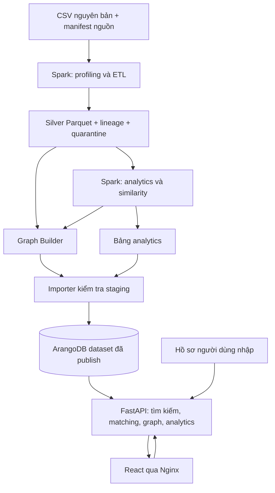

# Kế hoạch hoàn thiện hệ thống VietJobs bằng Apache Spark và ArangoDB

Ngày lập: 13/10/2026. Trạng thái: **đặc tả và kế hoạch triển khai**, không phải báo cáo các chức năng đã hoàn thành.

**Bản hướng dẫn triển khai v2:** [Kế hoạch chốt và hướng dẫn sử dụng dữ liệu](ke-hoach-trien-khai-vietjobs-v2.md). Đọc v2 trước: các quyết định bổ sung về môi trường, lương, quarantine, scoring, similarity, đánh giá và lịch thực hiện trong v2 thay thế các quy tắc tương ứng của bản v1 này. Các phần còn lại là đặc tả kỹ thuật tham chiếu, không phải tính năng đã triển khai.

Tài liệu này thống nhất dữ liệu, kiến trúc, nghiệp vụ, triển khai và nghiệm thu. Các đường dẫn/script/API ghi là **đề xuất** chưa tồn tại nếu không được đánh dấu hiện có. Không chạy các lệnh minh họa như một quy trình đã được cài đặt.

## Mục lục

1. [Phạm vi và thuật ngữ](#1-phạm-vi-và-thuật-ngữ)
2. [Hiện trạng và khoảng cách](#2-hiện-trạng-và-khoảng-cách)
3. [Chức năng lõi và nghiệm thu](#3-chức-năng-lõi-và-nghiệm-thu)
4. [Kiến trúc toàn hệ thống](#4-kiến-trúc-toàn-hệ-thống)
5. [Tổ chức mã nguồn và môi trường](#5-tổ-chức-mã-nguồn-và-môi-trường)
6. [Hợp đồng dữ liệu](#6-hợp-đồng-dữ-liệu)
7. [Pipeline Spark từ A đến Z](#7-pipeline-spark-từ-a-đến-z)
8. [Graph và nhập ArangoDB](#8-graph-và-nhập-arangodb)
9. [Job Similarity](#9-job-similarity)
10. [Matching và Skill Gap](#10-matching-và-skill-gap)
11. [API và giao diện](#11-api-và-giao-diện)
12. [Kiểm thử và thực nghiệm](#12-kiểm-thử-và-thực-nghiệm)
13. [Lộ trình triển khai](#13-lộ-trình-triển-khai)
14. [Vận hành, cập nhật và khôi phục](#14-vận-hành-cập-nhật-và-khôi-phục)
15. [Đối chiếu đề cương và bàn giao](#15-đối-chiếu-đề-cương-và-bàn-giao)

## 1. Phạm vi và thuật ngữ

### 1.1. Mục tiêu

Xây dựng nguyên mẫu khám phá và gợi ý việc làm từ VietJobs: Spark xử lý theo lô; ArangoDB lưu thực thể và quan hệ; FastAPI phục vụ truy vấn; React trình bày kết quả. Người dùng nhập kỹ năng và ưu tiên, nhận Top-K có giải thích, xem công việc tương tự, khám phá graph và thống kê dataset.

Tên mô tả đề xuất: **Hệ thống khám phá và gợi ý việc làm dựa trên mạng lưới kỹ năng bằng ArangoDB và Apache Spark**. Nếu tên đăng ký phải giữ nguyên, giải thích “giới thiệu” là recommendation và “mạng lưới” là quan hệ Job–Skill–Category–Location.

| Thuật ngữ | Nghĩa được dùng trong kế hoạch |
|---|---|
| Recommendation / gợi ý | Xếp hạng việc làm theo hồ sơ và nội dung dataset |
| Referral | Nhờ một người giới thiệu vào doanh nghiệp; module cũ, ngoài luồng VietJobs |
| Raw | Tệp nguồn nguyên vẹn, chưa chuẩn hóa |
| Clean | Dữ liệu biến đổi theo quy tắc có phiên bản và dấu vết nguồn |
| Snapshot | Bản công bố dữ liệu; không chứng minh tin đang tuyển |
| Run | Một lần chạy pipeline với đầu vào, cấu hình, phiên bản và kết quả xác định |
| Skill Gap | Kỹ năng tin đề cập nhưng hồ sơ chưa khai báo; không khẳng định ứng viên không có |
| Điểm phù hợp | Điểm theo công thức; không phải xác suất được tuyển |

### 1.2. Phạm vi bắt buộc

Spark profiling/ETL/analytics; bảo toàn nguồn; import graph hợp lệ; tìm kiếm và chi tiết; Top-K có giải thích; Job Similarity; Skill Gap cơ bản; graph explorer; dashboard; benchmark; tài liệu tái lập.

Ngoài phạm vi lõi: nhà tuyển dụng đăng tin, ứng tuyển/ATS, referral qua người quen, xác minh nhân viên, chat, email, upload/phân tích CV, học từ hành vi, Kafka/streaming, dự đoán tuyển dụng. Không xóa module cũ chỉ để đổi định hướng; bảo toàn và tách khỏi điều hướng VietJobs.

Không tự điền công ty, logo, URL ứng tuyển, ngày đăng, trạng thái còn tuyển hoặc trình độ kỹ năng khi dataset không chứng minh. Không tuyên bố hệ thống có chức năng độc quyền so với nền tảng thương mại.

## 2. Hiện trạng và khoảng cách

### 2.1. Những gì đã có

- React/TypeScript, FastAPI, ArangoDB 3.12.12 và Docker Compose chạy được.
- Bộ migrations hiện tại 001–005; API modular; auth/profile/jobs/matching/graph/referral và kiểm thử.
- `DATA_/De_cuong_trien_khai_BigData.docx`: đề cương nhấn mạnh Spark, graph thực thể tuyển dụng và recommendation.
- `DATA_/vietjobs-network/data/raw/vietjobs/VietJobs.csv`: dữ liệu nguồn.
- `DATA_/vietjobs-network/src/spark/01_profile_dataset.py`: script khảo sát Spark ban đầu, chưa phải pipeline hoàn chỉnh.
- `database/benchmark.py`: benchmark graph xã hội giả lập; không dùng số đo của nó để đại diện VietJobs.

Database `job_referral` được kiểm tra ở phiên trước có 25 users, 3 công ty demo, 6 jobs demo, 4 skills và graph xã hội. Đây là snapshot kiểm tra, phải đọc lại trước khi chuyển đổi. Catalog 29 tin public trong `database/catalog` là nguồn khác, không phải VietJobs.

### 2.2. Số liệu khảo sát CSV cục bộ

Các số dưới đây được đo bằng Python CSV, **chưa phải kết quả Spark**. Khi pipeline chạy, đối chiếu và giải thích mọi sai khác.

| Chỉ số | Giá trị |
|---|---:|
| Dung lượng | 103.110.903 byte |
| Dòng dữ liệu | 48.092 |
| Cột | 18 |
| Ngành | 16 |
| Tin Việt Nam / ngoài Việt Nam | 47.957 / 135 |
| Bản ghi dư do trùng hoàn toàn 18 cột | 385 |
| Thiếu technical_skills | 6.437 |
| Thiếu soft_skills | 2.641 |
| Thiếu languages_required | 35.796 |
| Thiếu working_hours | 4.982 |
| Lương min và max cùng bằng 0 | 13.730 |
| Chuỗi location có dấu phẩy | 2.903 |

Danh sách không thiếu của technical_skills/soft_skills/qualifications/benefits parse thành list được; vẫn cần kiểm tra nội dung. Một mẫu `salary` là 9,4–12 triệu nhưng cột min ghi 9: cần bảo toàn độ chính xác và ghi xung đột. Có 1.906 tin CNTT; không thiết kế taxonomy chỉ cho ngành IT.

### 2.3. Khoảng cách cần xử lý

Schema jobs hiện gắn công ty và trạng thái nghiệp vụ; VietJobs không có cột công ty/URL/ngày đăng. Graph hiện có không chứa categories/locations/similar_to. Matching hiện cần actor đăng nhập và dùng trọng số khác. Word đề xuất Streamlit nhưng dự án có React; chọn giữ React/FastAPI để tận dụng phần hoạt động.

## 3. Chức năng lõi và nghiệm thu

| ID | Chức năng | Hành vi và điều kiện hoàn thành |
|---|---|---|
| D01 | Pipeline dữ liệu | Raw → clean Parquet → analytics/graph, có manifest và báo cáo chất lượng; chạy lại được |
| F01 | Tổng quan | Số jobs/skills/categories/locations khớp phiên bản đã publish; ghi rõ snapshot |
| F02 | Tìm kiếm | Lọc tiêu đề/ngành/địa điểm/kỹ năng/kinh nghiệm/lương/hợp đồng trên toàn tập trước phân trang |
| F03 | Chi tiết | Nội dung nguồn, trường chuẩn hóa, thiếu dữ liệu, provenance, kỹ năng và việc tương tự |
| F04 | Top-K | Hồ sơ nhập → thứ tự ổn định, điểm thành phần, coverage và giải thích |
| F05 | Skill Gap | Kỹ năng khớp/chưa khai báo, gắn với job cụ thể; không tự tạo khóa học hay cam kết tuyển dụng |
| F06 | Similar Jobs | Top-N từ dữ liệu có kỹ năng, điểm Jaccard, kỹ năng chung; không trả chính job |
| F07 | Graph Explorer | Job–Skill–Category–Location, subgraph có giới hạn và trạng thái truncated |
| F08 | Analytics | Ngành/địa điểm/kỹ năng/lương/kinh nghiệm; công khai mẫu số, dữ liệu loại và phạm vi |
| O01 | Tái lập/vận hành | Có lệnh thực tế, readiness, backup/restore, benchmark và hướng dẫn chạy từ đầu |

Job Similarity là bắt buộc để khớp mục nghiệm thu Word. Skill co-occurrence, MinHashLSH và NLP là mở rộng sau khi baseline hoàn thành.

## 4. Kiến trúc toàn hệ thống



### 4.1. Hai luồng độc lập

**Batch:** operator chạy Spark → ghi artifacts → kiểm tra → import vào database mới → publish. Browser không kích hoạt Spark và runtime API không có quyền import.

**Online:** React gửi filter/profile → API validate → repository AQL lấy dữ liệu → service tính điểm/DTO → React hiển thị. Analytics đọc bảng đã tính; không chạy Spark mỗi lần mở trang. Dataset công khai được đọc không cần đăng nhập trong luồng khám phá mới; lưu hồ sơ cá nhân là tùy chọn dùng auth hiện có và database cũ.

### 4.2. Trách nhiệm

| Thành phần | Trách nhiệm | Không làm |
|---|---|---|
| Spark | ETL, explode kỹ năng/địa điểm, aggregate, similarity batch | Gọi HTTP theo từng thao tác người dùng |
| Graph Builder | ID, vertices/edges và validation | Bịa doanh nghiệp/quan hệ xã hội |
| Importer operator | Ghi staging theo batch, resume, xác nhận count | Dùng root trong API |
| ArangoDB | Document, edge, named graph, index, AQL | Tự suy diễn dữ liệu nguồn |
| FastAPI | Validation, query limits, matching, response contract | Đọc CSV toàn bộ mỗi request |
| React/Nginx | Tương tác và trực quan hóa | Tính toàn bộ thống kê dataset ở browser |

### 4.3. Tách dữ liệu mới và cũ

Giữ `job_referral` cho users/auth/nghiệp vụ cũ. Mỗi lần publish VietJobs dùng database mới `vietjobs_<run_id_an_toan>` với schema riêng và named graph `vietjobsGraph`. API mới có connection dataset riêng; không đổi toàn bộ `ARANGO_DATABASE` của backend cũ sang database này vì startup/policy cũ sẽ không tương thích.

V1 matching nhận profile tạm trong request, không cần cạnh profiles. Nếu cần lưu: auth users cũ quản lý hồ sơ; truyền snapshot kỹ năng sang dataset service. Không tạo cạnh ArangoDB giữa hai database. Việc thêm profiles và cạnh của profile chỉ là mở rộng có migration riêng.

## 5. Tổ chức mã nguồn và môi trường

### 5.1. Cấu trúc đề xuất

```text
DATA_/vietjobs-network/
  data/raw/vietjobs/VietJobs.csv           # hiện có, giữ nguyên
  data/manifests/source.json              # đề xuất
  data/runs/<run_id>/silver/              # Parquet, lineage, quarantine
  data/runs/<run_id>/gold/analytics/       # Parquet + JSONL summary
  data/runs/<run_id>/gold/graph/           # vertices/edges JSONL
  data/runs/<run_id>/reports/              # quality, timing, manifest
  config/                                # schema, aliases, scoring, thresholds
  src/spark/01_profile_dataset.py         # hiện có, cần cải tiến
  src/spark/02_clean_dataset.py            # đề xuất
  src/spark/03_build_analytics.py          # đề xuất
  src/spark/04_build_similarity.py         # đề xuất
  src/graph/build_graph.py                 # đề xuất
  pipeline.py                             # entrypoint đề xuất
database/vietjobs/                         # schema/bootstrap/import/validate riêng
backend/modules/vietjobs/                  # schemas/service/repository/api riêng
frontend/src/features/vietjobs/            # các màn hình đề xuất
tests/vietjobs/                            # ETL/DB/API và integration
docs/reports/vietjobs/                     # bằng chứng chọn lọc để bàn giao
```

Không tạo hai ứng dụng frontend/backend độc lập trong DATA_. Không sửa migrations 001–005 vì đã có checksums. Namespace schema VietJobs có version riêng; không thay graph/schema cũ bằng graph mới.

### 5.2. Môi trường và tài nguyên

- Tách môi trường ETL khỏi `.venv` backend; pin Python/PySpark/Java tương thích sau smoke test. Chưa chốt phiên bản Spark chỉ dựa vào tên tài liệu `latest`.
- Bắt đầu Spark `local[2]`, cấu hình driver memory/shuffle partitions qua tham số; đo rồi điều chỉnh. Không mặc định `local[*]` là tối ưu.
- ArangoDB/Nginx/FastAPI dùng Compose hiện có. Spark là job theo lô, có profile/container hoặc môi trường local riêng.
- Tệp CSV multiline đơn lẻ có thể hạn chế song song bước đọc; sau bronze ingestion chuyển Parquet rồi repartition để xử lý tiếp. Không tuyên bố nhiều workers làm bước đọc này nhanh hơn nếu chưa đo.
- Ổ C/E đã từng ít dung lượng; kiểm tra lại trước mỗi run. Cho phép output trên ổ D qua cấu hình; không hardcode đường dẫn máy phát triển.
- Master/worker chỉ là mở rộng khi chạy được thật; cùng máy Docker không phải chứng minh nhiều máy vật lý.
- Pin dependency bằng lockfile, ghi actual versions/CPU/RAM/OS/Spark master trong manifest; secrets chỉ ở môi trường operator, không trong artifacts.

## 6. Hợp đồng dữ liệu

### 6.1. Schema nguồn

Đọc 18 cột dưới dạng string ở bronze để tránh mất số thập phân/chuỗi nguồn. Kiểm tra tên và thứ tự header, không âm thầm chấp nhận thiếu/thêm cột. Schema raw gồm:

`job_title, location, country, qualifications, technical_skills, soft_skills, languages_required, experience_required, salary, contract_type, working_hours, benefits, description, requirements_text, category, salary_min, salary_max, salary_avg`.

### 6.2. Mapping đích

| Nguồn | Đích | Quy tắc |
|---|---|---|
| job_title | title_raw, title, title_search | Giữ gốc; Unicode NFC/trim/space cho display; search riêng |
| description | description_raw, description | Không bỏ nội dung dài hoặc HTML như thể đã xác minh; render text an toàn |
| requirements_text | requirements_raw, requirements | Null nếu thiếu, không tự tạo yêu cầu |
| category | category_key | Dictionary 16 ngành versioned; category mới phải qua kiểm tra |
| location/country | location_raw, location_keys, country_key | Multi-location; dictionary alias; giữ unresolved |
| technical_skills/soft_skills | technical_skill_keys, soft_skill_keys | Parse list, normalize, distinct, giữ loại và tên raw |
| qualifications | qualifications | List văn bản; chưa tự suy ra bằng cấp chính thức |
| languages_required | languages_raw, language_keys | Dictionary ngoại ngữ; unresolved nếu chưa nhận diện |
| experience_required | experience_raw, experience_min_years | Tháng/12; “Không yêu cầu” = 0 được biết, không phải null |
| salary/min/max/avg | salary_raw, salary_min_vnd, salary_max_vnd, salary_status | Parse decimal có đơn vị; nullable; lưu numeric_raw để đối chiếu |
| contract_type | contract_type | Alias có phiên bản; không đổi thành remote/hybrid |
| working_hours/benefits | working_hours, benefits | Giữ nội dung và list; không dùng làm bằng chứng work_mode |
| Metadata tạo mới | provenance, quality_flags, run_id | Nguồn, checksum, parser version; không phải ngày đăng |

`salary_period` = unknown nếu nguồn không chỉ rõ kỳ trả; `currency` chỉ gán khi đủ bằng chứng. Lương có đơn vị tiền nhưng thiếu kỳ trả vẫn được hiển thị nguyên văn; loại khỏi so sánh lương tháng cho đến khi có quy tắc xác nhận. Không gọi median dataset là lương thị trường hiện tại.

### 6.3. ID và lineage

- `source_file_sha256` xác định file; manifest chứa repository/revision nếu xác minh được, thời điểm nhận file và checksum. Không suy ra download time là publication time.
- Khi đọc CSV bằng parser chuẩn một lần, tạo **source_record_ordinal** (số thứ tự record logic, không phải số dòng vật lý) và JSONL bronze kèm các 18 giá trị raw. Bước này phục vụ lineage; Spark thực hiện phần ETL/analytics sau đó. Đối chiếu count Spark CSV và JSONL để phát hiện parser khác nhau.
- `source_record_id = SHA256(file_sha256 + ordinal)`. Không dùng `monotonically_increasing_id` làm danh tính nguồn ổn định.
- `content_hash` là SHA256 của JSON canonical chứa đủ 18 giá trị raw, thứ tự trường cố định, quy tắc null rõ ràng. Hash theo nội dung không chứng minh danh tính một tin đăng ngoài đời.
- V1 chỉ gộp trùng raw chính xác. `job_id = vj_<content_hash>`; lineage bảng riêng liên kết một job tới tất cả source_record_ids. Không gộp theo title/location vì có thể mất tin khác nhau.
- Near-duplicate chỉ gắn cluster/cờ khảo sát, không tự xóa. Giữ ID khi đổi dictionary chuẩn hóa; sửa nội dung raw có thể tạo ID khác và được coi snapshot mới.
- Skill key hash `(skill_type, canonical_name)`; location key hash `(country, canonical_location)`; category key từ mapping. Alias phải có kiểm thử chống nhập nhằng; hash collision kiểm tra nội dung trước import.

### 6.4. Schema clean tối thiểu

Job gồm ID/hash/provenance; title/description/requirements; category_key/location_keys; technical/soft skill keys; qualifications/languages; experience; salary/currency/period/status; contract/working_hours/benefits; quality_flags; snapshot state `historical_unknown`. Không dùng `open` của jobs cũ để giả định tin còn tuyển.

## 7. Pipeline Spark từ A đến Z

### 7.1. P00 — Preflight và nguồn

Đầu vào: CSV hiện có và config. Kiểm tra file đọc được, header, disk/RAM, dependency versions, nguồn/điều kiện sử dụng và phạm vi công bố. Tính SHA256 streaming; tạo manifest. Chỉ tạo run mới, không ghi đè raw. Chưa xác minh revision nguồn thì ghi `unknown`, không bịa revision.

Đầu ra: source manifest, bronze JSONL có lineage, record counts. Lỗi nguồn/schema dừng toàn run.

### 7.2. P01 — Spark đọc và profiling

Đọc CSV với schema string explicit; `header=true`, `multiLine=true`, UTF-8, quote/escape phù hợp CSV đã kiểm tra; dùng header validation và theo dõi corrupt records. Đối chiếu parser bronze để bắt thiếu/thừa cột vì permissive không tự phát hiện mọi lỗi cấu trúc.

Persist DataFrame được tái sử dụng rồi materialize một lần; gộp missing/count aggregates thay vì action mỗi cột; unpersist khi xong. Đo riêng cold read và thời gian dùng cache.

Thống kê: count, missing từng cột, distinct, duplicates chính xác, quốc gia/ngành/contract/experience, độ dài text, list errors, salary issues, location unresolved. Phân biệt null/empty/null-token với list rỗng; ghi rule normalization.

Đầu ra: `profile.json`, bảng phân bố và time stages; đối chiếu 48.092 dòng của file hiện tại. Không hardcode số này cho file khác.

### 7.3. P02 — Cleaning và chuẩn hóa text

Giữ raw columns, tạo clean columns bằng Unicode/trim/whitespace. Không xóa dấu tiếng Việt trong display; search folding có cột riêng. Bản ghi thiếu title hoặc description/quy tắc bắt buộc không hợp lệ vào quarantine kèm reason; thiếu kỹ năng/lương không làm loại cả job.

Không ghi đè raw, không dùng placeholder như “Công ty ABC”. Xử lý text như dữ liệu, không thực thi HTML/script.

### 7.4. P03 — Parse list và taxonomy

Parse Python-list bằng `ast.literal_eval` có giới hạn độ dài/size/depth, kiểm tra đúng list of strings; không `eval`, không thay dấu nháy toàn chuỗi để giả JSON. UDF trả struct gồm values/status/error, hoặc mapPartitions để xử lý có kiểm soát; ưu tiên built-in Spark cho normalization/explode/join.

Technical/soft là hai loại riêng. Trim, NFC, loại phần tử rỗng, distinct; alias mapping nhỏ broadcast join. Chỉ gộp alias đã duyệt; không gộp Java với JavaScript. Qualifications/benefits giữ list văn bản, không ép thành technical skills.

Chính sách parse lỗi: giữ job, raw và flag; thành phần skill unknown; không biến parse error thành “không yêu cầu kỹ năng”. Xuất sample lỗi để operator xem.

### 7.5. P04 — Location/country/category/experience

Quốc gia: dictionary có label nguồn và key. Giữ 135 tin ngoài Việt Nam, UI mặc định filter Việt Nam nhưng analytics toàn tập phải ghi scope.

Địa điểm: tách dấu phẩy và delimiters được xác nhận, dictionary alias; bảo toàn tên lịch sử, không tự đổi địa giới nếu không có bảng mapping và thời điểm. Dấu phẩy chỉ là candidate delimiter, không đảm bảo 2.903 dòng đều là nhiều địa điểm. Lưu token chưa rõ, không tự gán tỉnh; báo cáo tỷ lệ unresolved.

Category: ánh xạ sang 16 key ổn định, label Việt dễ đọc. Unknown category dừng publish hoặc bổ sung mapping có kiểm thử.

Experience: hỗ trợ các giá trị `n năm`, `n tháng`, “Không yêu cầu”. Tháng/12 bằng decimal/double có quy tắc; không suy ra seniority từ số năm. Nếu requirements_text mâu thuẫn cột experience, giữ cột raw và flag conflict; không âm thầm chọn yêu cầu cao hơn.

### 7.6. P05 — Lương

Giữ toàn bộ raw salary/min/max/avg. Parser có bảng mẫu: range, một giá trị, thỏa thuận, trên/dưới, unknown. Decimal dùng khi tính tiền, không dùng int để cắt phần lẻ.

V1 ưu tiên chuỗi salary khi parse rõ đơn vị; numeric columns là đối chứng. Ví dụ 9,4–12 triệu → 9.400.000–12.000.000 VND nếu currency đủ rõ; ghi flag khác numeric_min=9. Chuỗi và số mâu thuẫn không giải thích được → conflict, không đưa vào statistics/matching lương.

Zero–zero là cờ kiểm tra, không tự coi 13.730 bản ghi đều “thỏa thuận”. Chỉ gán negotiable khi nội dung chứng minh; còn lại unknown. Min > max, âm, đơn vị mâu thuẫn, số không hữu hạn → invalid. Không loại outlier chỉ vì lương cao; giữ cờ và dùng robust statistics.

Không lấy salary_avg đã làm tròn thay midpoint. Analytics midpoint chỉ tính khi đủ hai bounds và cùng tiền tệ/kỳ trả; lương một phía báo riêng. Coverage lương và số records bị loại phải xuất cùng kết quả.

### 7.7. P06 — Dedup và export Silver

Dedup content_hash chính xác, merge lineage. Nếu chỉ có 385 duplicate raw và không loại job nào khác thì còn 47.707 unique; đây là phép đối chiếu dự kiến, không phải KPI ép pipeline đạt.

Xuất `jobs_clean.parquet`, `job_skills.parquet`, `job_locations.parquet`, dictionaries, lineage và quarantine. Một job có thể thiếu kỹ năng nhưng vẫn tìm kiếm được. Mỗi stage có status/count/time/schema version.

Đối chiếu: raw = quarantined logical records + retained source records; retained source records = unique clean jobs + duplicate occurrences removed. Phải dùng cùng định nghĩa khi tính. Các số missing sau explode không được so trực tiếp với số jobs.

Ghi thư mục staging của run; chỉ đánh dấu hoàn thành khi tất cả validation pass. Không ép `coalesce(1)` cho toàn bộ output; số partition được đo và cấu hình. Không partition theo title/skill vì cardinality cao.

### 7.8. P07 — Spark analytics

Tạo bảng jobs_by_category, jobs_by_country/location, skills_frequency, experience_distribution, salary_summary, data_quality. Dùng explode + distinct(job_id, skill/location) trước đếm để không nhân bản.

Một job nhiều locations được tính tại mỗi địa điểm, nên tổng location counts có thể lớn hơn jobs; UI phải giải thích. Skill frequency = số jobs distinct có skill, không phải số lượt từ trong text. Soft/technical thống kê riêng.

Lương thống kê theo currency/period, scope country/category; median/quantiles và sample size; không trộn missing=0. Không có date nguồn thì không dựng biểu đồ xu hướng theo tháng/năm. Dataset imbalance không được diễn giải là toàn thị trường.

Đầu ra Parquet cho tái phân tích và JSONL document nhỏ cho API; cả hai gắn run_id/config hash.

### 7.9. P08 — Similarity và graph export

Chạy thuật toán mục 9, export jobs/skills/categories/locations và cạnh mục 8. Validate độc lập trước import. Không collect toàn graph vào driver; writer JSONL nhiều part files, importer đọc streaming. Không ghi DB từng row từ executor trong v1 vì retry task có thể ghi trùng và khó kiểm soát commit.

### 7.10. P09 — Chốt run

Manifest cuối: input checksum, schema/parser/dictionary/scoring versions, code revision nếu có, config checksum, thời gian, counts, filenames/artifact checksums, reject reasons, partition/master/memory actual, validation results. Run complete không đồng nghĩa đã publish database.

## 8. Graph và nhập ArangoDB

### 8.1. Schema riêng trong dataset database

| Collection | Loại | Nội dung |
|---|---|---|
| jobs | vertex | Clean jobs/provenance/quality flags |
| skills | vertex | Canonical name/type/raw aliases |
| categories | vertex | Ngành nghề |
| locations | vertex | Địa điểm/quốc gia/cờ unresolved |
| requires_skill | edge | jobs → skills, type/source extraction; không tự thêm proficiency |
| in_category | edge | jobs → categories |
| located_at | edge | jobs → locations |
| similar_to | edge | jobs → jobs, directed Top-N, score/shared_skill_keys/config version |
| analytics | document | Bảng tổng hợp có scope/sample size/run_id |
| dataset_runs | document | Manifest/status/version |
| source_lineage | document | Job → source IDs; không dùng một mảng vô hạn trong job |

Named graph `vietjobsGraph` chỉ chứa collections/edge definitions tương ứng. Similar_to Top-N theo từng job nên có hướng; A trong Top-N của B không bắt buộc B trong Top-N của A. Jaccard score vẫn đối xứng trước bước chọn Top-N.

### 8.2. Index và truy vấn

- Primary/edge indexes dùng cho keys và traversal; unique compound `_from,_to` cho cạnh mỗi loại, requires_skill type nằm trong skill identity.
- Persistent index theo bộ lọc đo thực tế: country, category, experience, salary applicability; không giả rằng index thường tăng tốc substring title.
- ArangoSearch/inverted index cho tìm kiếm text là bước triển khai riêng, analyzer được kiểm tra tiếng Việt và phiên bản 3.12; fallback substring phải đo full scan và giới hạn runtime. Không gọi tìm kiếm ngữ nghĩa nếu chỉ substring.
- Filter trước pagination, sort có tie-breaker key; không tải toàn dataset rồi filter ở React.
- Truy vấn job–skill, job–category/location, similar_to và graph path có bind variables, allowlist collection, timeout/memory/output limits.

### 8.3. Import staging

1. Operator xác nhận run complete và checksum artifacts.
2. Tạo database tên mới riêng cho run; reject nếu trỏ `job_referral` hoặc database chưa được xác nhận owned staging.
3. Bootstrap schema riêng; import vertices trước, edges sau, analytics/manifest cuối.
4. Batch khởi điểm 1.000 documents, đo RAM/time rồi điều chỉnh; kiểm tra lỗi từng document và HTTP batch. Không coi HTTP 200 là tất cả rows thành công.
5. `_key` ổn định; retry cùng batch không nhân bản. Có checkpoint collection/part/batch/checksum; input đổi phải tạo run mới.
6. Dataset bất biến theo run; update chỉ cho staging cùng run/nội dung hợp lệ. Không import trộn nguồn catalog 29 tin vào VietJobs.
7. Validate counts, uniqueness, schema, endpoint edges, scores, sample lineage và analytics reconciliation.
8. Tạo runtime DB user read-only cho dataset; operator credential tách khỏi API.
9. Đánh dấu ready; cấu hình API trỏ dataset DB mới, restart và kiểm tra readiness/run_id. Đây là bước publish riêng sau review kết quả staging.

Import nhiều batch không phải một transaction toàn dataset. Database staging và bước publish cuối ngăn người dùng thấy một nửa dữ liệu. Không áp dụng helper transaction cũ khóa 19 collections cho ETL này.

### 8.4. Gate publish bắt buộc

Không edge mồ côi, không duplicate keys, counts khớp manifest; mỗi job có một category, số location edges khớp mapping, skill edges chỉ đến skills tồn tại; no self similar_to; điểm trong [0,1]; public runtime không có write privilege; API/UI/analytics cùng run_id; có phương án quay về database cũ.

## 9. Job Similarity

V1 chỉ dùng tập technical skills đã chuẩn hóa, để tránh soft skills phổ biến làm mọi job giống nhau. Jaccard `|A∩B|/|A∪B|`; cả hai rỗng = không đủ dữ liệu, không phải 1. Không có kỹ năng thì không tạo similar_to baseline.

### 9.1. Sinh candidate có giới hạn

Build inverted index skill → jobs. Chọn tối đa một số skill ít phổ biến nhất mỗi job (khởi điểm 3), bỏ skill quá phổ biến khỏi **candidate generation**, không khỏi full skill set khi tính Jaccard. Ghép jobs trong cùng category và share selected skill, chuẩn hóa unordered pair và dedup, sau đó tính intersection/union đầy đủ.

Giới hạn tần suất skill, số candidates/job (khởi điểm 500), Top-N (10) và min_score (0,2) là cấu hình thử nghiệm, không phải kết quả đã tối ưu. Trước join, thống kê độ lớn nhóm và estimated pair count; nếu vượt budget thì thu hẹp group/partition, không chạy cross join. Candidate cap phải deterministic, ghi số candidates bị cắt và thừa nhận approximation; không đảm bảo global exact Top-N.

Không so toàn bộ 48.092 jobs: có 1.156.396.186 unordered pairs. Kiểm tra lại phép tính trong code/report; ordered pairs gần 2,3 tỷ không đồng nghĩa unordered pairs.

### 9.2. Kết quả và đánh giá

Sort score desc, shared_count desc, job_id asc; giữ directed Top-N, export score/shared keys. So baseline với brute-force trên mẫu nhỏ stratified theo category; đo candidate recall@N, thời gian và edge count. Lọc cùng category có thể bỏ quan hệ xuyên ngành; ghi rõ, không tuyên bố toàn bộ cơ hội tương tự đã tìm được.

MinHashLSH là mở rộng khi baseline đắt: binary feature vector và distance = 1−Jaccard; kiểm tra vocabulary/hash collision, zero vectors, seeds, params và recall. Không đổi thuật toán giữa ETL/API mà không thay version.

## 10. Matching và Skill Gap

### 10.1. Đầu vào và truy xuất

Profile request: technical/soft skill keys, preferred category/location/country, experience_years, salary expectation/currency/period nếu có, contract types, Top-K. Không nhận roles/verified/employer identity.

Người dùng chọn tiêu chí **bắt buộc** riêng với tiêu chí **ưu tiên**. Hard filters được áp dụng trước ranking. Nếu bắt buộc lương mà job unknown: loại và báo số loại; nếu chỉ ưu tiên: giữ nhưng không cho điểm lương. Quốc gia mặc định Việt Nam là scope rõ ràng.

Baseline lấy candidate theo filters từ ArangoDB, stream/paginate nội bộ để tính điểm toàn tập eligible; không chỉ chấm page đầu rồi gọi Top-K toàn bộ. Nếu tối ưu candidate qua skill traversal, response phải ghi candidate strategy/total/truncation và đo recall so baseline. Với profile không có skills, dùng tiêu chí khác và báo thiếu kỹ năng, không trả điểm skill giả.

### 10.2. Công thức baseline có phiên bản

Trọng số khởi điểm theo Word: skill 0,50; category 0,20; location 0,15; experience 0,10; salary 0,05. V1 soft skills/languages hiển thị riêng, chưa cộng điểm cho đến khi có đánh giá; không âm thầm gộp taxonomy khác loại.

| Thành phần | Quy tắc v1 |
|---|---|
| Skill | số technical skills job khớp profile / số technical skills job; tập rỗng hoặc parse lỗi → unknown |
| Category | 1 khi thuộc preferred set, 0 khi khác; profile không chọn → disabled |
| Location | 1 khi ít nhất một location đã resolve khớp; không có thông tin tin cậy → unknown |
| Experience | min(1, candidate_years / required_years); required=0 → 1; thiếu bên nào → unknown/disabled |
| Salary | 1 nếu job max hoặc bound xác nhận đáp ứng desired minimum cùng currency/period; 0 nếu chắc chắn không; thiếu/conflict → unknown |

Let W = tổng trọng số các tiêu chí người dùng kích hoạt; A = các tiêu chí có dữ liệu đủ để chấm. `score_observed = 100*Σ(w_i*s_i)/Σ_A(w_i)`, `coverage = Σ_A(w_i)/W`, `ranking_score = score_observed*coverage`. Nếu W hoặc Σ_A bằng 0: score null, thông báo cần thêm tiêu chí; không chia 0.

UI hiển thị điểm theo tiêu chí đã biết và coverage, giải thích điểm ranking. Không cho job thiếu kỹ năng thành điểm tuyệt đối chỉ vì trùng địa điểm. Unknown không khẳng định mismatch, nhưng giảm bằng chứng để xếp hạng. Threshold và trọng số phải được đánh giá, không viết “80% được tuyển”. Sort ranking desc, coverage desc, job_id asc.

### 10.3. Skill Gap

`matched = job_skills ∩ profile_skills`; `not_declared = job_skills − profile_skills`; phân biệt technical/soft. Nếu nguồn không rõ required/preferred thì dùng “kỹ năng được tin đề cập”. Hiển thị mapping nguồn và cờ extraction. Không tự đánh giá mức thành thạo.

Mở rộng sau v1: tổng hợp kỹ năng chưa khai báo trong Top-K mục tiêu, đếm distinct jobs có kỹ năng đó; trình bày “xuất hiện trong N tin liên quan”, không khẳng định học kỹ năng sẽ được tuyển. Dữ liệu khóa học cần nguồn khác, không có trong kế hoạch lõi.

## 11. API và giao diện

### 11.1. API mới đề xuất

Prefix `/api/v1/vietjobs` tránh xung đột API jobs/referral cũ.

| Method/path sau prefix | Dữ liệu |
|---|---|
| GET /dataset | run_id, source, counts, quality summary |
| GET /jobs | q/category/location/country/skill/experience/salary/contract, offset/limit |
| GET /jobs/{id} | Clean fields + raw display/provenance/quality flags |
| GET /jobs/{id}/similar | Top-N + score/shared skills |
| GET /skills, /categories, /locations | Dictionaries, pagination/autocomplete |
| POST /recommendations | Profile tạm → Top-K/explanations/coverage/strategy |
| GET /graph | Root job/skill, relation allowlist, depth/node/edge limits |
| GET /analytics/{metric} | Scope, denominator, exclusions, rows, run_id |

Response lists có items/has_more/run_id; pagination defaults 20/max100. Recommendation Top-K default10/max50; graph depth≤2, nodes≤80, edges≤150 là limits khởi điểm cần cấu hình. Không trả credentials/system collections/raw paths của máy.

Readiness gồm dataset state ready và kiểm tra collection/schema/query tối thiểu, không chỉ DB ping. Query timeout/limit lỗi có thông báo; không trả mock fallback. API giữ cùng một dataset connection snapshot trong request; publish cần restart/reload có kiểm soát.

### 11.2. Giao diện

| Màn hình | Thành phần bắt buộc |
|---|---|
| Tổng quan | Dataset version, lịch sử/unknown hiring state, counts, phân bố, quality |
| Tìm kiếm | Filters hợp lệ, reset, pagination, empty/error/loading; không lọc riêng page |
| Chi tiết | Title/content/requirements/benefits/raw salary, missing flags, provenance, similar jobs |
| Gợi ý | Form hồ sơ, hard/preference filters, kết quả có điểm/coverage/explanation/skill gap |
| Graph | Root selector, types legend, node detail, giới hạn/truncated, liên kết job detail |
| Analytics | Country/category scope, metric definition/sample sizes, tables/charts, null exclusions |

Menu mới trỏ các route VietJobs riêng. Đăng nhập có thể để lưu hồ sơ, không chặn xem public snapshot. Không đổi network page xã hội thành graph kỹ năng mà giữ API cũ bên dưới. Không đưa nút “nhờ giới thiệu”, “ứng tuyển ngay” vào job VietJobs.

## 12. Kiểm thử và thực nghiệm

### 12.1. Ma trận kiểm thử

| Lớp | Ca quan trọng | Bằng chứng |
|---|---|---|
| Raw/parser | CSV multiline/quotes/Unicode/thiếu cột; source ordinals | Parser reconciliation |
| ETL | List lỗi/rỗng; Java≠JavaScript; địa điểm nhiều; 6 tháng; salary9,4; zero/conflict | Unit nhỏ và Spark integration |
| Lineage/dedup | Đảo thứ tự input không đổi content keys; exact duplicate merge lineage; không gộp job chỉ giống title | ID/reconciliation report |
| Graph/import | Duplicate batch retry; partial failure/resume; missing endpoints; schema drift; runtime read-only | DB integration staging |
| Similarity | Jaccard có đáp án; empty sets; no self; cap/ties; brute-force sample | Recall/time report |
| Matching | Profile không skill; missing salary; hard filters; Top-K toàn candidate; coverage/ties | Scoring/API tests |
| Analytics | Multi-location double-count explanation; distinct skills; lương unknown excluded | Spark↔DB reconciliation |
| Browser | Search→detail→similar; profile→rank→gap; graph; scope đổi biểu đồ; lỗi API | Playwright trên DB riêng |
| Vận hành | Ready sai khi import chưa xong; chuyển dataset/quay lại; restore | Runbook evidence |

Test fixtures dùng tập nhỏ có đáp án, không thay bộ dữ liệu chính. Test database UUID sở hữu riêng; cleanup chỉ đúng database đã tạo. Không chạy seed demo vào dataset staging để “có dữ liệu”.

### 12.2. Benchmark

- ETL cùng input/config: local[1]/[2]/[4], cùng cold/warm policy; ghi read/transform/shuffle/write riêng, stage startup riêng, CPU/RAM/partitions/spill/output size.
- Ít nhất 3 lần mỗi cấu hình để báo median/min/max, không lấy lần nhanh nhất làm kết luận.
- AQL: search phổ biến/hiếm, category/location/skill filter, detail/similar, graph degree cao/thấp, recommendation sparse/dense profile; warmup tách ra, ít nhất 30 queries cho mỗi nhóm để báo p50/p95/min/max và sai số hạn chế.
- Dùng EXPLAIN/PROFILE xác nhận execution plan/index, so trước/sau index trên cùng snapshot và máy. `database/benchmark.py` cũ không thay thế benchmark này.
- Ngưỡng mục tiêu ban đầu, không phải đã đạt: p95 search/detail dưới 2 giây, recommendation dưới 3 giây trên máy demo; nếu không đạt ghi số đo và tối ưu, không sửa báo cáo để che lỗi.
- Đánh giá gợi ý với ≥20 profile đại diện ngành, ít nhất 2 người đánh giá Top-10, rubric skill/category/location/experience; Precision@K/NDCG nếu có nhãn đủ, disagreement ghi rõ. Profile/labels là thử nghiệm, không dữ liệu ứng viên thật.
- Ưu tiên đánh giá retrieval recall và exact baseline trước tuyên bố chất lượng ranking; không dùng điểm scoring làm accuracy.

## 13. Lộ trình triển khai

Ước lượng 15 ngày làm việc có thể điều chỉnh sau milestone đầu; không phải lịch cam kết. Không bỏ gate chỉ để kịp ngày. Tận dụng ứng dụng cũ giúp giảm UI work, nhưng ETL/data integration vẫn cần làm đầy đủ.

| Milestone | Ngày dự kiến | Công việc/file chính | Phụ thuộc | Gate hoàn thành |
|---|---|---|---|---|
| M0 | 1 | Chốt scope/schema; source manifest; env Spark smoke test | Không | Input/parser/version được xác nhận |
| M1 | 2 | Cải tiến profiling script và output reports | M0 | Spark count khớp CSV, report lưu được |
| M2 | 3–5 | Clean/list/location/experience/salary/dedup + Silver | M1 | Unit/integration và reconciliation pass |
| M3 | 6 | Analytics và graph builder | M2 | Counts/edges/provenance hợp lệ |
| M4 | 7 | Dataset bootstrap/import/resume/runtime user | M3 | Staging read-only, zero orphan |
| M5 | 8–9 | Similarity candidates/Top-N và đánh giá mẫu | M2,M4 | No self, đúng công thức, recall report |
| M6 | 10 | API search/detail/dictionaries/analytics/graph | M4 | Contract và AQL integration pass |
| M7 | 11 | Matching/coverage/gap | M6 | Ranking baseline và profile tests pass |
| M8 | 12–13 | React sáu màn hình/routes | M5–M7 | Browser flows dùng đúng run_id |
| M9 | 14 | Benchmark, labels, rollback/restore | M8 | Reports và khôi phục có bằng chứng |
| M10 | 15 | Publish staging, cập nhật Word/README/slides/demo | M9 | Checklist bàn giao hoàn tất |

Nếu có hai người: Data/Spark phụ trách M0–M3/M5; Graph/API/UI phụ trách M4/M6–M8; cả hai review data contract và M9–M10. Đây là phân công đề xuất cho nhóm, không phải yêu cầu tự chạy nhiều agent.

Thứ tự backlog trong từng milestone: contract → implementation → meaningful tests → report → review. Không xây UI với mock rồi để import data đến cuối.

## 14. Vận hành, cập nhật và khôi phục

### 14.1. Giao diện lệnh cần xây

Các lệnh sau là **đặc tả CLI dự kiến**, chưa chạy được cho đến khi tạo entrypoints; triển khai xong phải thay bằng câu lệnh đã smoke-test trên PowerShell từ repository root.

```powershell
# ĐỀ XUẤT: ETL environment cần được cài/pin riêng trước đó.
<etl-python> DATA_/vietjobs-network/pipeline.py preflight --config <config>
<etl-python> DATA_/vietjobs-network/pipeline.py profile --run-id <run>
<etl-python> DATA_/vietjobs-network/pipeline.py clean --run-id <run>
<etl-python> DATA_/vietjobs-network/pipeline.py analytics --run-id <run>
<etl-python> DATA_/vietjobs-network/pipeline.py similarity --run-id <run>
<etl-python> DATA_/vietjobs-network/pipeline.py graph --run-id <run>
<etl-python> DATA_/vietjobs-network/pipeline.py validate --run-id <run>
.venv/Scripts/python.exe -m database.vietjobs.cli import --run-id <run> --database <owned-staging>
.venv/Scripts/python.exe -m database.vietjobs.cli validate --database <owned-staging>
```

CLI cần `all` để chạy tuần tự, `--resume`, stage dependencies, `--dry-run` import, exit code≠0 khi lỗi. Không truyền password qua CLI; đọc env được tài liệu hóa. Stage skip phải kiểm checksum đầu vào/outputs, không chỉ `_SUCCESS`.

### 14.2. Publish và rollback

Trước publish: giữ config/database cũ; xác nhận snapshot mới ready; backup và kiểm tra restore trên database riêng. Chỉ chuyển dataset connection mới sau staging review. Restart backend, kiểm readiness, API counts, UI và cùng run_id; không tự chạy lại seed/import public catalog.

Rollback bằng cấu hình dataset DB trước và restart; artifacts/run mới giữ để điều tra, không xóa volume. Profiles/auth vẫn ở database cũ nên chuyển dataset không xóa tài khoản. Saved skill keys không còn trong snapshot phải đánh dấu unavailable, không tự gán sang skill khác.

### 14.3. Backup

Chọn logical backup bằng công cụ ArangoDB tương thích đang cài, backup cả schema/index/graph/manifest/dataset và dữ liệu user riêng; bảo vệ credential/backup. Test restore vào DB riêng và so count/index/graph/provenance. Backup VHDX chỉ là bổ sung khi Docker dừng hoàn toàn, không thay thế logical restore test.

### 14.4. Cập nhật dữ liệu

Dataset mới → run mới → ETL → staging DB mới → gates → publish; không sửa snapshot đã publish tại chỗ. So sánh counts/missing/skills/ID churn và lý do; lineage cho phép biết record nào giữ/đổi. Không scheduler real-time trong v1; operator cập nhật có kiểm soát.

### 14.5. Xử lý sự cố

| Sự cố | Hành động |
|---|---|
| Thiếu disk/Java/Spark lỗi | Dừng preflight, sửa môi trường; không publish |
| Count Spark khác parser | Kiểm multiline/encoding/header/corrupt; dừng ETL gate |
| Parser/list/salary conflict | Quarantine hoặc flag theo chính sách, xuất samples; không bịa giá trị |
| Similarity pair explosion | Dừng trước join, giảm candidate budget/đổi generation; ghi approximation |
| Import một phần | Dataset staging, resume checksum; không để UI đọc |
| Runtime 401 | Kiểm user/permission đúng database; không đổi API sang root |
| Schema cũ không khớp mới | Tách connections/bootstrap; không sửa checksum migrations cũ |
| UI count khác analytics | Kiểm scope/run_id và distinct denominator; chưa nghiệm thu |
| Query chậm | PROFILE/EXPLAIN, indexes/candidate strategy; đo lại |

## 15. Đối chiếu đề cương và bàn giao

### 15.1. Chỉnh đề cương Word khi triển khai

Giữ Word gốc làm tham chiếu; bản cập nhật cần thống nhất tên/định nghĩa recommendation, React/FastAPI thay Streamlit, schema graph thực tế, Job Similarity bắt buộc, Skill Gap cơ bản, thực nghiệm có coverage/recall và tiến độ theo milestone. Không viết số đo dự kiến thành kết quả đã đạt; giữ cấu trúc báo cáo mà giảng viên yêu cầu.

### 15.2. Ma trận bằng chứng

| Phần báo cáo | Bằng chứng cần có |
|---|---|
| Nguồn và chất lượng | Source manifest/checksum/profile report, quy tắc xử lý |
| Spark | Code ETL, Spark versions/master/stage logs, Parquet và timing |
| Graph ArangoDB | Collection/edge definitions/counts, validation, AQL/PROFILE |
| Gợi ý và similarity | Công thức/version, examples, labels/recall/quality report |
| Giao diện | Browser tests, screenshots cùng dataset version |
| Thực nghiệm | Benchmark config/raw measurements/summary, giới hạn |
| Vận hành | README verified commands, backup/restore/rollback evidence |
| Làm việc nhóm | Task/commit/đầu ra thực tế; không điền phân công giả |

### 15.3. Kịch bản demo xuyên suốt

1. Mở nguồn CSV và manifest, giải thích 18 cột và missing data.
2. Chạy Spark trên nguồn hoặc trình bày log/artifacts run đã hoàn thành với checksum; không gọi việc trình chiếu là chạy trực tiếp.
3. Đối chiếu raw/clean/quarantine/dedup và kiểm tra một dòng có salary decimal.
4. Mở ArangoDB: jobs/skills/categories/locations, edges và truy vấn Job–Skill.
5. Mở ứng dụng: search/filter/detail đúng dataset, ghi rõ historical snapshot.
6. Nhập profile → Top-K → xem score/coverage/matched/not-declared.
7. Xem similar jobs và kỹ năng chung; mở graph giới hạn.
8. Đổi scope dashboard, giải thích denominator và lương unknown.
9. Trình bày benchmark, kết quả đánh giá và giới hạn nguồn/thuật toán.

### 15.4. Checklist hoàn thành

- [ ] Raw nguyên vẹn, nguồn/điều kiện sử dụng và checksum được ghi.
- [ ] Spark thực hiện ETL/analytics thật, có môi trường pin và run tái lập.
- [ ] Mọi trường clean có quy tắc/version/lineage; không bịa company/date/status.
- [ ] Counts đầu vào/đầu ra khớp định nghĩa, errors/quarantine có báo cáo.
- [ ] Staging import/resume/unique/index/edge endpoints pass.
- [ ] API public đọc dataset bằng runtime read-only, auth/profile cũ không bị mất.
- [ ] Sáu màn hình dùng cùng dataset version; không mock fallback.
- [ ] Top-K đúng candidate scope, có coverage và giải thích.
- [ ] Similarity có candidate limits và đánh giá recall, không cross join toàn tập.
- [ ] Analytics ghi scope/mẫu số/exclusions; không dựng timeline không có ngày nguồn.
- [ ] Benchmark/labels/browser/restore có bằng chứng thực tế.
- [ ] README/Word/slides khớp implementation, lệnh được kiểm tra từ đầu.
- [ ] Nghiệp vụ referral/social cũ được tách khỏi luồng VietJobs, dữ liệu cũ bảo toàn.

## Tài liệu tham chiếu

- Nội bộ: `DATA_/De_cuong_trien_khai_BigData.docx`, CSV và script profiling trong DATA_; README/compose và source hiện tại. Đề cương định hướng, không tự chứng minh đã triển khai.
- [VietJobs trên Hugging Face](https://huggingface.co/datasets/dinhieufam/VietJobs): nguồn được người dùng chọn; xác minh revision/điều kiện sử dụng trước phân phối.
- [Spark CSV](https://spark.apache.org/docs/latest/sql-data-sources-csv.html): cấu hình reader/header/schema; tài liệu latest có thể thay đổi, dùng bản tương ứng môi trường đã pin.
- [Spark ML features / MinHashLSH](https://spark.apache.org/docs/latest/ml-features.html): tham khảo mở rộng similarity, không phải thành phần đã triển khai.
- [ArangoDB 3.12 query profiling](https://docs.arango.ai/arangodb/3.12/aql/execution-and-performance/query-profiling/): phương pháp xem execution plan và số đo truy vấn.

