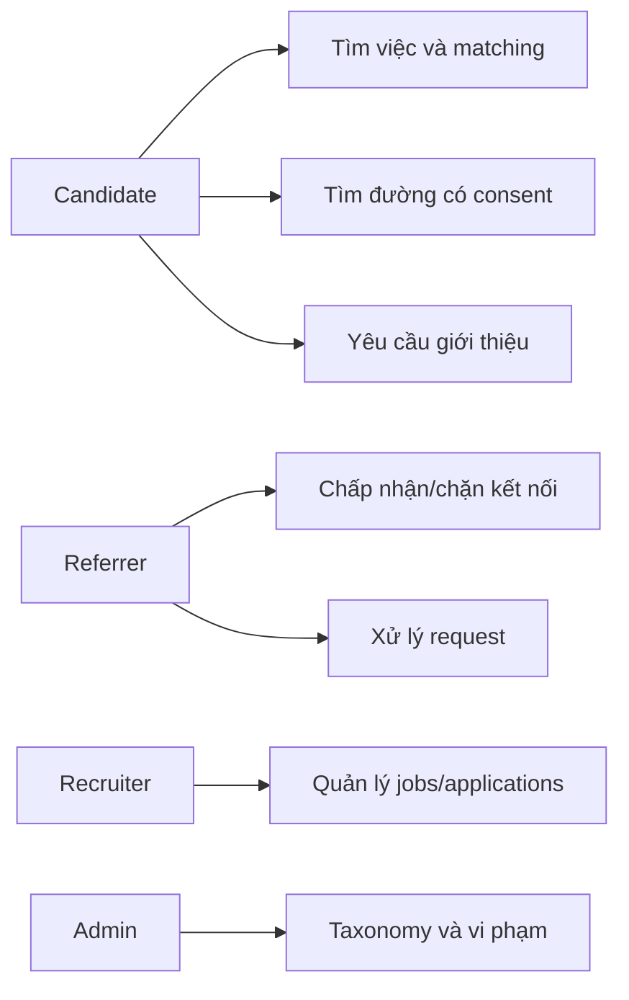
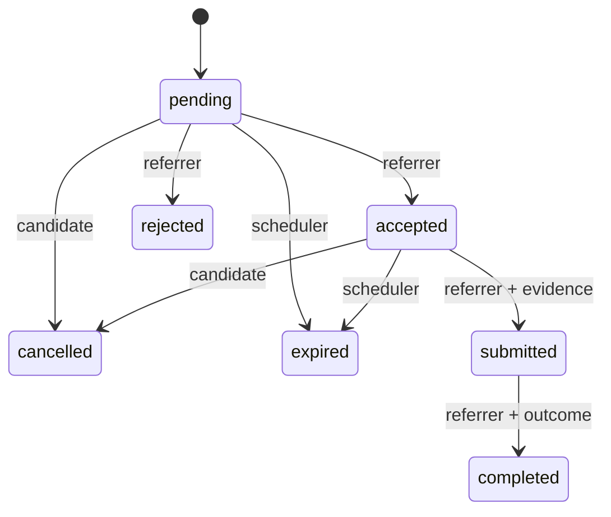

# Phase 1 — yêu cầu và acceptance criteria

Tài liệu này ghi baseline Phase 1–2. Backend Phase 3 và các core modules hiện đã
triển khai; trạng thái thực tế, authorization và acceptance API nằm ở
[backend.md](backend.md), [testing.md](testing.md) và [API contract](api.md).

MVP: người dùng nhiều vai trò (candidate/referrer/recruiter/admin), hồ sơ và privacy,
kết nối có đồng thuận, công ty và quyền thành viên, jobs/skills, matching có giải
thích, đường giới thiệu 1–3 bước, application, referral workflow, notifications,
audit. Phase 1–2 chỉ bàn giao thiết kế và database foundation; auth/API/UI sẽ làm
ở phase sau. Không phát triển UI trước khi gate P2 đạt.

| Actor | User story | Quyền |
| --- | --- | --- |
| Candidate | Xem đường A → B → C tới công ty X để nhờ giới thiệu | Chỉ graph có consent, chỉ gửi cho referrer còn làm tại X |
| User/referrer | Chấp nhận kết nối và chọn phần hồ sơ chia sẻ | Chỉ nhận lời mời thuộc mình; chặn có hiệu lực ngay |
| Referrer | Nhận/chấp nhận/từ chối/gửi/hoàn thành referral | Chỉ request gửi cho mình |
| Recruiter | Đăng/đóng job và xem applications có consent | Phải có membership owner/recruiter đã xác minh, không dựa chỉ vào works_at |
| Admin | Quản lý taxonomy, xử lý vi phạm | Audit bắt buộc, không mặc định được đọc CV/private graph |

Business rules: một cạnh/cặp người dùng; pending/rejected/blocked/deleted không
là kết nối; cùng công ty không tự là bạn. Một application/user/job. Một referral
candidate/referrer/job suốt vòng đời MVP (unique, kể cả terminal); có thể gửi tới
nhiều referrer khác nhau, rate limit ở Phase 4. Retry cùng idempotency key trả
record cũ khi payload trùng, payload khác trả 409. Không gửi lại request đã
terminal trong MVP; muốn cho phép sau này cần migration/version rule mới.
Giới hạn MVP là tối đa 3 referrers/job/candidate và 10 referral requests/ngày;
service Phase4 enforce quota trong transaction. Database Phase2 mới enforce
triplet/idempotency uniqueness, không coi quota đã được triển khai.

Referral state machine đã chốt:

Tạo request và accepted → submitted phải revalidate user/job/employment/path;
đường hiển thị không phải quyền ghi vĩnh viễn. Transaction gồm request,
notification, audit; dùng `_rev` optimistic concurrency cho chuyển trạng thái.
Rejection/cancel/expiration lưu lý do và timestamps, không xóa lịch sử. Workflow
write service chưa triển khai trong Phase 2; schema và seed lưu đủ dữ liệu.

| AC | Điều kiện pass và bằng chứng yêu cầu |
| --- | --- |
| P1-01 | Scope, actors, stories, rules, permissions, workflow được ghi rõ |
| P1-02 | Module boundaries, API contracts và security policies rõ trạng thái thiết kế |
| P1-03 | Graph/edge directions/unique/index/retention được chốt thành manifest |
| P2-01 | Bootstrap hai lần giữ dữ liệu; journal version/checksum; không reset |
| P2-02 | Collection types, strict schema, graph definitions, indexes đúng; drift fail |
| P2-03 | Seed transaction có >=20 users, nhiều jobs/companies/states; chạy lại an toàn |
| P2-04 | A → B → C đúng 2 bước; chiều ngược ANY; nhiều đường và shortest hợp lệ |
| P2-05 | Pending/rejected/blocked/deleted, account inactive, privacy, former/unverified employee bị loại; job closed bị loại |
| P2-06 | Matching có required/preferred, experience, level, location, work mode, salary explanation; network không đẩy job thiếu năng lực lên đầu |
| P2-07 | Bind vars, depth <=3, limit <=100, offset <=1000, timeout và memory cap |
| P2-08 | Unique email/application/referral/job-company/edge; transaction abort không partial writes |
| P2-09 | Integration tests trên ArangoDB thật không skip/mock; EXPLAIN/PROFILE và benchmark có artifact |

Edge cases: missing IDs trả empty/not-found theo API; input invalid trả 422;
cycle không lặp node; cạnh đã xóa làm đường đứt; quyền đổi làm path biến mất;
employment end_at chạm as_of không hợp lệ; không có skill thì score thành phần
skill = 0; job không requirements không tự cho 100% skill. Hồ sơ ẩn có thể làm
đường ngắn nhất khả dụng dài hơn đường không có consent.
